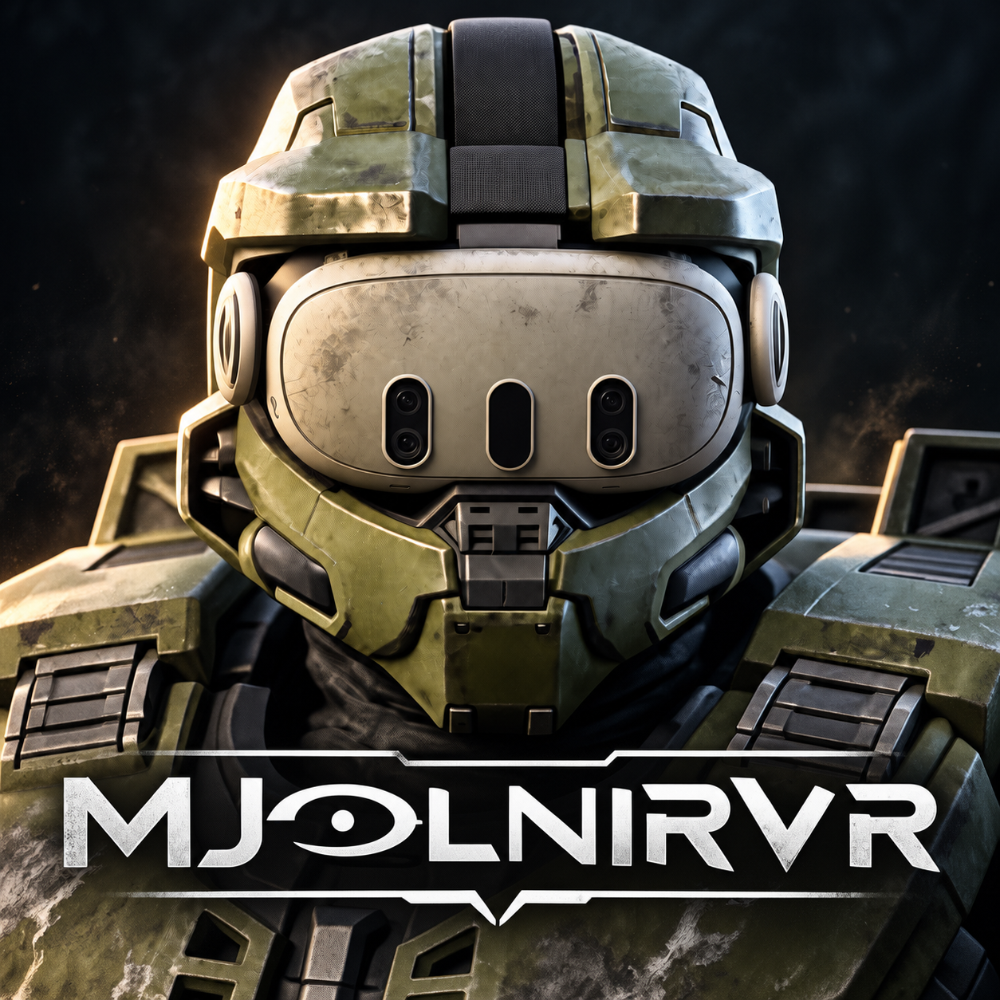

  

# MjolnirVR

MjolnirVR: play the Halo MCC campaigns in VR, inside the Mjolnir armour.

MjolnirVR lets you play the **single-player campaigns** of Halo: The Master Chief Collection in virtual reality, in first person, with tracked hands. It covers all six games: **Halo CE, Halo 2, Halo 3, Halo 3: ODST, Halo: Reach and Halo 4**. It works with any OpenXR headset; it is built and tested on a Quest 3 over Virtual Desktop.

You aim and hold guns with your real hands, use two hands on a gun for steadier aim, holster guns at your hip and shoulder, punch and swing at enemies, look down a scope to zoom, and navigate menus with a laser pointer. You need your own copy of MCC on Steam or the Microsoft Store.

> **Please read first**
> - **Campaign / single-player only.** There is no multiplayer, matchmaking or online play.
> - **Easy Anti-Cheat must be off.** The mod starts MCC in its anti-cheat-disabled mode. Never use it while playing online.
> - This is a work-in-progress test build. Keep a backup of your MCC install and of your `halomccvr.cfg` settings file.

## Where this stands

Status as of 30 October 2026.

- **All six campaigns start and play in VR** in first person with tracked hands. Reach, Halo 3, ODST and Halo CE have had the most headset time.
- **Zoom works in every game, but needs polish.** Each gun's scope lens is placed on its real scope glass using measurements from the official modding kits; the picture does not fit the glass perfectly on every gun yet, and Reach's scope picture still renders incorrectly.
- **Releases are built from tags.** Each release on the Releases page is the code at that tag, built on GitHub; the Install section says what lands where.
- **What has been proven in a headset** versus only by the automated test rig is listed below. The rig is a fake OpenXR headset with fake hands that plays the game and checks results, so "rig only" means it works by the numbers but nobody has felt it yet.

| Feature | Status |
|---|---|
| First-person tracked view and hands, all six games | Proven in headset |
| Two-hand grip, physical melee | Proven in headset |
| Holsters (hip and shoulder) and the belt grab for grenades and equipment | Built; not yet reliable in the headset |
| Scope zoom with the lens on the real scope glass; visor zoom for guns without an optic | Works in every game, needs polish: the picture does not fit the glass on every gun, and Reach renders it incorrectly |
| Menus with the laser pointer; in-game settings menu (F1) | Proven in headset |
| Reach vehicles; 90 fps in Reach | Proven in headset |
| Halo 4 visor frame | Proven in headset |
| Cockpit screens inside enclosed vehicles; turret handles; pause screen lock | Rig only |
| Snap turn, turn vignette, vehicle vignette, cabin fade | Rig only |
| Left-handed mode | Rig only; needs its own full test pass |
| Grab-the-wheel steering | Built, **off by default** (stick steering is the default after a headset test found the wheel steering the wrong way) |
| Snap-in magazine reload | Built, **off by default**; not yet proven |
| Per-piece HUD placement (Reach) | Built, **off by default** |
| Co-op | Not supported |

## Install

Three ways. Each one ends with a `Halo_MCC_VR` folder inside your MCC folder, with the mod and the MjolnirVR launcher in it. Nothing else is written to your PC; `docs/WHAT-IT-TOUCHES.md` lists every file, folder and setting the mod reads or writes.

1. **Launcher package.** Download `MjolnirVR-<version>-Build.zip` from the Releases page, extract it to an ordinary folder (the installer refuses to run from a junction or symbolic link), run `HaloMCCVRLauncher.exe` and click **Install VR mod**. It finds your MCC folder (Steam or Xbox app) or lets you pick it, checks every file against the package manifest, backs up a previous install, and keeps your settings file. If MCC lives under `Program Files`, run the launcher as administrator for this step only.
2. **By hand.** Download `MjolnirVR-<version>-Manual.zip` and copy its `Halo_MCC_VR` folder into your base MCC folder (for example `C:\Program Files (x86)\Steam\steamapps\common\Halo The Master Chief Collection`, not `Binaries\Win64`).
3. **From source.** Clone this repository and follow `BUILDING.md`: three commands build and test it, and `tools/package.ps1` produces the same two zips as a release. Then use either way above with your own package.

Then close MCC, connect your headset (for Quest: start Link, Air Link or Virtual Desktop and open the OpenXR runtime), and start the game from `HaloMCCVRLauncher.exe` in `Halo_MCC_VR`. Starting MCC directly from Steam or the Xbox app will not load the mod.

**Checking a download.** Every release lists SHA-256 hashes in `SHA256SUMS.txt`, and every file is built by this repository's GitHub Actions workflow with a build provenance attestation (`gh attestation verify <file> -R vainamoinen-dev/MjolnirVR`). `docs/CODE-SIGNING.md` explains why Windows SmartScreen still warns on first run.

**About the file names.** MjolnirVR used to be called Halo MCC VR, and its legacy internal name was halo3xr. The files keep their HaloMCCVR names (`HaloMCCVR.dll`, `HaloMCCVRLauncher.exe`, `halomccvr.cfg`, the `Halo_MCC_VR` folder), so existing installs and settings carry over. A settings file from the oldest builds (`halo3xr.cfg`, the legacy name) is imported automatically.

## Controls (Quest Touch)

One layout with the same meaning in every game. An action a game does not have (sprint in Halo CE, for example) simply does nothing there.

| Control | Action |
|---|---|
| **Right trigger** | Fire |
| **Left trigger** | Throw grenade |
| **A** | Jump |
| **B** (tap) | Reload |
| **B** (hold) | Use, enter a vehicle, pick up |
| **X** | Sprint (Halo 4) |
| **Y** | Switch weapon |
| **Right stick click** | Zoom (the game's zoom; raising the gun to your eye also zooms) |
| **Left stick click** | Equipment / armour ability |
| **Left stick** | Move |
| **Right stick** | Turn (snap or smooth, your choice in the menu) |
| **Click both sticks together** | Recenter and open or close the mod menu (same as **F1** on the keyboard) |
| Grip on the gun | Hold the gun; squeeze the second hand's grip near the front to hold with two hands |
| Reach to hip or shoulder, squeeze grip | Switch weapon (holsters; still being tuned) |
| Swing the gun or your fist | Melee |
| Crouch | Physically crouch |
| Touch your head with the empty hand | Flashlight (CE) / VISR (ODST) |
| Grab behind your support-side hip | Switch grenade type; in Halo 3, equipment can also be taken from the front belt and tossed (still being tuned) |

Vehicles: steer with the stick (or grab the wheel, if you turn that on), right trigger drives, left trigger brakes, the gun hand aims turrets. Keyboard extras: **F1** menu, **F2** head tracking on/off, **F3** recenter, **F6** positional tracking on/off, **F8**/**F9** pitch trim.

Quest Touch has no D-pad; the mod never puts an action there. The menu's Mappings page has per-game overrides if you want something different. Settings are saved per game in `halomccvr.cfg`; the menu rewrites that file when it saves. `docs/MCC-PAD-BINDING.md` explains how the mod talks to MCC's own gamepad layer.

## How it is built

MjolnirVR began as a fork of MCCVR by pancreations, which got all six MCC campaigns running in a headset with tracked hands. Everything here stands on that work, and a great deal of it still is that work.

On 8 October 2026 the code was reorganised around one rule: **one shared VR core, one thin adapter per game.** That layout is what makes it practical to add features to all six games at once.

- `src/dll/core/` is the game-agnostic core: OpenXR session and frame loop, Direct3D 11 hook, input, the in-headset menu, hook helpers.
- `src/dll/titles/<game>/` is each game's adapter: where its camera, weapons, vehicles and HUD live in memory, and the handful of hooks that game needs.
- `src/common/` holds pure logic with no game dependency (scope lenses, holsters, melee, zoom windows, vehicle seats, settings migration), each piece with unit tests in `tests/`. The build runs the tests; most of the mod's rules can be checked without starting the game.
- Every hook goes through a shared registry so it can be installed and removed cleanly, and a game-code safety check (signature or byte proof) is never weakened to make something work.
- Features default to what really happens: if a thing has a physical answer in real life (a scope you look through, a wheel you grab, a crouch you do with your legs), that is the default, and a button is the fallback.

With that layout, a feature built once applies to all six games by filling in that game's adapter, and a change in one adapter cannot break another game. It also means a fake-headset test rig can play every game and check each build against the code before a human puts the headset on.

## Known issues

- **Scope picture fit.** The zoomed picture does not sit perfectly inside the glass on every gun yet.
- **Reach scope picture.** Reach still renders the zoomed picture incorrectly: it can miss characters and flicker. Being worked on.
- **Holsters and belt grab** do not yet work reliably in the headset.
- **Halo 3 smoke and fog** can look wrong when you move your head in some areas.
- **Reach looks grainy.** The cause is understood (Reach's lost temporal anti-aliasing plus sharpening). Sharpening is off by default and Reach defaults to FXAA at 1.30x render scale, with one-click alternatives under F1 > Picture. See `docs/REACH-GRAIN.md`.
- **Halo CE vehicles:** the driver seat position was recently corrected but is not yet proven in a headset. Resuming a save while seated is unreliable.
- **Seated resume (Halo 2 and others):** if you load a save made inside a vehicle, you may start outside first-person seat mode. Leave and re-enter the seat.
- **Only one headset is tested.** Development and testing use a Quest 3 with Touch controllers. Other OpenXR headsets and controllers load the standard interaction profiles but have not been tried.
- **Co-op and multiplayer are untested.** The mod is built and tested against the campaigns.
- **No body.** The games draw arms only while a weapon is held, so an empty hand is invisible.
- **Security software** may warn about the launcher and DLL: the mod injects a DLL into MCC and runs it without anti-cheat. The source is here; build it yourself if you prefer.

## Licences

- **MCCVR by pancreations**, the project MjolnirVR is built on.
- Libraries: Dear ImGui, MinHook (with the Hacker Disassembler Engine), the Khronos OpenXR SDK loader (with JsonCpp), SMAA by Jimenez et al., NVIDIA DLSS and NVIDIA Optical Flow SDKs, and the Oxanium font. Their licences are in `installer/THIRD-PARTY-LICENSES.txt` and `third_party/`.

## Not affiliated

Halo is a trademark of Microsoft. This project is not affiliated with or endorsed by Microsoft, 343 Industries or Halo Studios, and includes no game files. You need to own Halo: The Master Chief Collection.

## Bug reports

Open an issue here. Please include: the game and mission, Steam or Microsoft Store, headset and runtime, the mod version, and what you did. The wider Halo VR community meets at the [Flat2VR Discord](https://discord.gg/flat2vr).
